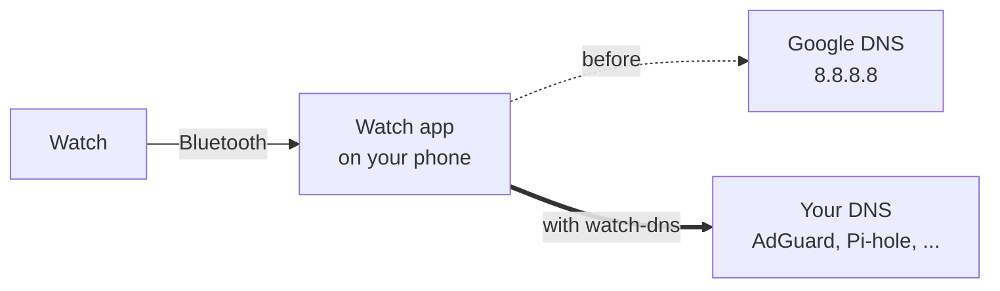

# watch-dns

**Block ads and trackers on your Wear OS watch, even when it's online through your phone.**

Set Private DNS on your watch to AdGuard (or any filtering DNS) and it works fine on Wi-Fi. Walk out the door and the watch says *"Network has no Internet access: Private DNS server cannot be accessed"*, and apps stop loading. Put it back on Automatic and everything works again, but now every lookup your watch makes goes to Google.

watch-dns fixes that from the phone side. One script, one command, and your watch uses the DNS server you choose over Bluetooth too.

## Why the watch can't do it alone

On Bluetooth, your watch isn't really online. It hands its traffic to a relay, and the watch app on your phone (Pixel Watch or Wear OS) sends it out. That relay passes web traffic and plain DNS, but not encrypted DNS-over-TLS, which is the only kind Android's Private DNS speaks. The watch's check fails, so it marks the connection as broken.

On Automatic, the phone's watch app answers the watch's lookups by asking Google (`8.8.8.8`) itself, which skips whatever Private DNS your phone uses.



## What it does

watch-dns adds a few firewall rules on your phone that apply **only to the watch apps**:

- their plain DNS lookups go to your DNS server instead of Google
- their encrypted lookups to Google are refused, so they fall back to plain ones (which then get redirected)
- their IPv6 lookups are refused, so they use IPv4 (many phone kernels can't redirect IPv6)

The watch app itself isn't changed, so its updates don't undo anything. Nothing else on your phone is touched.

## You need

- An Android phone with **root** (Magisk, KernelSU or APatch), where your root app allows **Shell**
- **adb** on a computer ([platform-tools](https://developer.android.com/tools/releases/platform-tools)), with USB or wireless debugging on the phone
- A Wear OS watch paired through the **Pixel Watch** or **Wear OS** app
- Your watch's **Private DNS on Automatic** (or Off), not on a hostname

## Quick start

```
bash watch-dns.sh
```

It finds your phone, checks root and the watch apps, shows what's going on, and gives you a menu:

```
  watch-dns  your DNS for a Wear OS watch, even over Bluetooth

  ✓ Phone: SM-S938B, Android 17  R5CX00000000
  ✓ Root
  ✓ Watch app: Pixel Watch app  paired with Pixel Watch 4

  · Off: over Bluetooth, the watch's lookups go to Google.
  · Rules last until the phone restarts.

What now?
  1  Turn on, or change the server
  2  Turn off
  3  Show status
  4  Check the watch's own setting
  5  Quit
  › 1

Which DNS server?
  1  AdGuard DNS          blocks ads and trackers
  2  AdGuard DNS Family   also adult sites, safe search on
  3  Cloudflare 1.1.1.2   blocks malware
  4  Quad9                blocks malware
  5  My own server        Pi-hole, AdGuard Home, any IPv4 address
```

**Check the watch's own setting** connects to your watch if it's on adb (wireless debugging) and tells you whether its Private DNS will get in the way. It can switch it to Automatic for you.

## Without the menu

```
bash watch-dns.sh on                     # AdGuard DNS
bash watch-dns.sh on --dns 9.9.9.9       # any IPv4 server
bash watch-dns.sh status                 # only reads, changes nothing
bash watch-dns.sh off
```

Add `--serial SERIAL` (or set `ANDROID_SERIAL`) when more than one device is connected.

## Good to know

**It resets when the phone restarts.** The rules live in memory. Run it again after a reboot (and after re-rooting, if your root is temporary).

**Status counts go up only on Bluetooth.** On Wi-Fi the watch goes online by itself and asks your router, so "0 sent" is normal at home. For AdGuard on Wi-Fi too, set it as the DNS server in your router.

**The redirected lookups aren't encrypted** between your phone and the DNS server. Your phone's own lookups keep whatever Private DNS you set.

**A home DNS server (Pi-hole, AdGuard Home)** only answers while your phone is on that network, or on a VPN to it like Tailscale or WireGuard.

**Why not patch the watch app?** A modified app has to be re-signed, which breaks Play updates and Google's own checks of the app. Firewall rules leave the app alone.

## Tested on

| Phone | Watch | Result |
|---|---|---|
| Galaxy S25 Ultra, Android 17, KernelSU | Pixel Watch 4 (API 37) | Rules apply, Google's encrypted lookups refused. Bluetooth fallback being confirmed. |

Tried it on something else? Open an issue with your phone, watch and what `status` says.

## License

MIT
